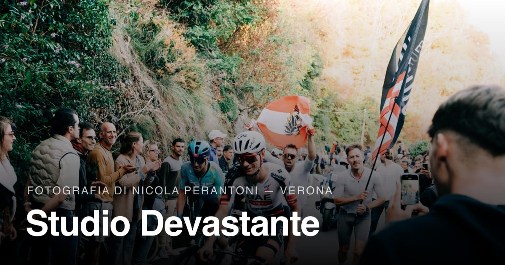

# Studio Devastante

[](https://www.nicolaperantoni.com)
[](https://astro.build)
[](https://www.typescriptlang.org)

Sito di **Studio Devastante**, lo studio fotografico di Nicola Perantoni, con base a Verona. In home c'è uno scroll orizzontale infinito di fotografie, con parallasse dentro ogni foto e le schede Profilo e Portfolio in mezzo. Le pagine interne (Servizi, Manifesto, Contatti) hanno un titolo a tutta larghezza e righe che compaiono scorrendo.



---

## Stack

Sito statico, zero backend, nessun framework UI:

- **[Astro](https://astro.build)** (output statico) + **TypeScript** strict
- **[GSAP](https://gsap.com)** con ScrambleTextPlugin per le animazioni (loader, menu, scheda Portfolio, foto dei servizi)
- **`astro:assets`** (`<Picture>`): foto in AVIF con fallback WebP, a più larghezze con `srcset`
- **Fonts API di Astro**: Sora e Archivo scaricati in build e serviti dal sito
- **`@astrojs/sitemap`** per la sitemap
- CSS puro con custom properties, niente Tailwind
- Deploy su **Vercel**, con Vercel Analytics

## Pagine

| Pagina | Italiano | Inglese |
|---|---|---|
| Home | `/` | `/en/` |
| Servizi | `/servizi/` | `/en/services/` |
| Manifesto | `/manifesto/` | `/en/manifesto/` |
| Contatti | `/contatti/` | `/en/contact/` |

Ogni pagina ha il proprio canonical, gli hreflang verso l'altra lingua, Open Graph e (in home) JSON-LD `ProfessionalService`.

## Funzionalità

- **Loader**: il titolo si rimescola (ScrambleText) mentre una barra nera avanza con il caricamento reale di font e foto. Alla fine il titolo vola al suo posto e le foto salgono dal basso.
- **Scroll orizzontale infinito**: rotella, trascinamento e frecce su desktop (con inerzia), scroll nativo su telefono. La sequenza è ripetuta tre volte e la posizione resta sempre nella copia centrale.
- **Parallasse**: ogni foto è larga il 140% della sua scheda e scorre al suo interno.
- **Scheda Portfolio**: col mouse la scritta cade con un rimbalzo e compare il pulsante per scaricare il PDF; su touch basta il primo tocco.
- **Servizi**: col mouse compare la foto del servizio, che segue il puntatore; su telefono la foto è nella riga.
- **Menu a tutto schermo** con voci grandi, recapiti, copyright e P.IVA.
- **Cursore "← Scorri →"** sullo scroll della home (solo mouse).
- **`prefers-reduced-motion`** rispettato ovunque.
- Email e numero WhatsApp ricomposti lato client, per non esporli ai raccoglitori di indirizzi.

## Sviluppo

```bash
npm install
npm run dev      # http://localhost:4321
npm run build    # output statico in dist/
npm run preview  # serve la build di produzione
npm run check    # type-check (astro check)
```

Script accessori, che rigenerano gli asset in `public/`:

```bash
npm run icons     # favicon.ico + apple-touch-icon.png da favicon.svg
npm run og-image  # preview social 1200×630
```

## Struttura

```
src/
├── pages/            # solo le rotte: ognuna monta una vista con la lingua (it / en)
├── views/            # Home, Services, Manifesto, Contact: corpo delle pagine, condiviso tra le lingue
├── layouts/
│   └── BaseLayout.astro   # <head> e SEO, testata (Menu, lingua, titolo), menu
├── components/       # TopBar, Menu, ContactList, ContactValue
├── lib/              # logica client-side in TypeScript (GSAP)
│   ├── loader.ts          # loader con ScrambleText e barra di avanzamento
│   ├── scroll.ts          # scroll orizzontale infinito e parallasse
│   ├── portfolio.ts       # scheda Portfolio
│   ├── menu.ts            # menu a tutto schermo
│   ├── cursor.ts          # cursore personalizzato
│   ├── service-preview.ts # foto dei servizi che segue il puntatore
│   ├── subpage.ts         # pagine interne: titolo e righe che compaiono
│   ├── fit.ts             # titoli a tutta larghezza (cqi)
│   ├── contacts.ts        # email e WhatsApp ricomposti lato client
│   └── env.ts             # preferenze del dispositivo
├── i18n/
│   ├── ui.ts          # tutti i testi per lingua e i percorsi delle pagine
│   └── utils.ts
├── data/
│   └── photos.ts      # sequenza delle foto in home e loro dimensioni
├── assets/photos/     # foto sorgenti (WebP), ottimizzate in build
└── styles/
    └── global.css     # design token e stili
```

Per cambiare le foto della home basta modificare `HOME_PHOTOS` in [`src/data/photos.ts`](src/data/photos.ts) e mettere i file in `src/assets/photos/`. Tutti i testi sono in [`src/i18n/ui.ts`](src/i18n/ui.ts).

## Design

- **Colori**: testo `#111112` su bianco, grigio `#8a8a8a` per le parti secondarie.
- **Tipografia**: [Sora](https://fonts.google.com/specimen/Sora) 600 per i titoli; [Archivo](https://fonts.google.com/specimen/Archivo) 400/500/600 per il testo.
- **Titoli a tutta larghezza**: la grandezza è calcolata in `cqi` misurando la parola, così riempie esattamente la riga a ogni schermo.

## Deploy

Push su `main` → build e deploy automatico su **Vercel**. Il dominio canonico è impostato in `site` di [`astro.config.mjs`](astro.config.mjs) (e nella riga `Sitemap:` di `public/robots.txt`).

## Crediti fotografici

Fotografie di Nicola Perantoni, tutti i diritti riservati.

---

© 2026 Studio Devastante di Nicola Perantoni
